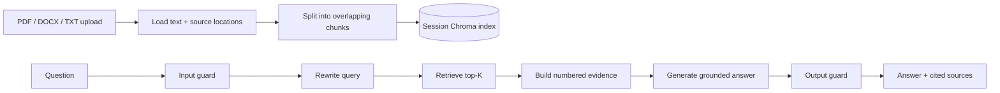

# Contract Review Agent

A Streamlit learning project that lets you upload contracts and ask questions grounded in their text. It follows the fitness agent's teaching pattern: separate ingestion and search modules, small LangGraph nodes, clear guardrails, and a visible UI.

## Run it

Requires Python 3.10+.

```powershell
cd contract-review-agent
python -m venv .venv
.venv\Scripts\Activate.ps1
pip install -r requirements.txt
copy .env.example .env
streamlit run app.py
```

Add an OpenAI key to `.env`, or choose Ollama and start a local Ollama model. The app also runs without an LLM key: retrieval still works and it shows the matching contract excerpts instead of generating a summary.

For a first run, upload `sample_contract.txt` and ask “Can the vendor increase the price?” or “How can either party terminate?”

## Architecture



1. `document_loader.py` extracts PDF pages, DOCX paragraphs/tables, or TXT text.
2. `chunker.py` makes overlapping chunks while keeping filename and page/paragraph labels.
3. `vector_store.py` embeds and searches chunks with Chroma's local embedding model.
4. `agent/graph.py` connects the question guard, query rewrite, retrieval, context, answer, and output check.
5. `app.py` is the Streamlit upload and chat interface. The Chroma collection is unique to the current app session and kept in memory.

With an LLM configured, answers use retrieved context only and cite numbered sources. Without one, the app presents retrieved excerpts, so the whole upload-to-retrieval flow can still be demonstrated offline after dependencies and Chroma's embedding model are installed. Scanned PDFs require OCR and are not supported here.

## Interview walkthrough

- **Ingestion:** file → extracted sections → overlapping chunks → embeddings.
- **Retrieval:** rewrite the question → nearest chunks → numbered context with source metadata.
- **Agent:** LangGraph passes one typed state through small nodes and routes blocked inputs to a refusal.
- **Grounding:** answer prompt requires citations and admits when evidence is missing; output guard checks for a citation.
- **Tradeoff:** a local Chroma index keeps the demo self-contained; production systems need authentication, durable tenant-isolated storage, access controls, audit logs, and stronger legal review workflows.

This is an educational aid, not legal advice. Verify all findings with a qualified lawyer before acting. Do not upload confidential contracts to an LLM provider unless your organization's data policy permits it.
